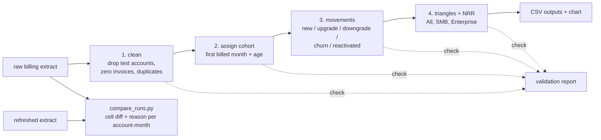
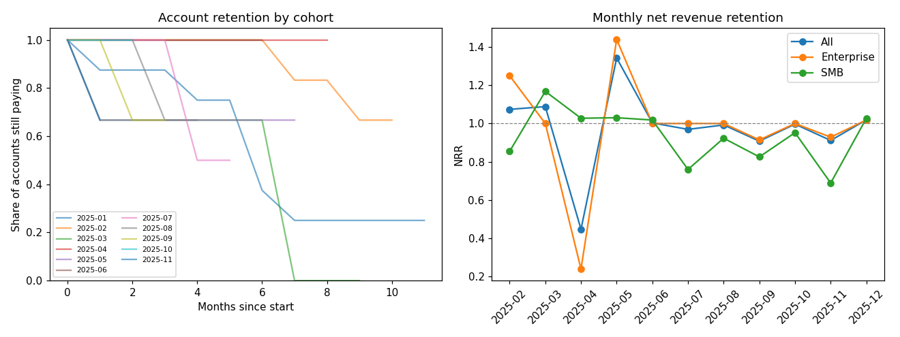

# SaaS Cohort Retention Pipeline

## Overview
A small, reproducible pipeline that turns monthly billing records of a subscription
business into the classic cohort views: revenue and account-retention triangles,
churned accounts, upgrade/downgrade value per cohort, and monthly net revenue
retention (NRR), split by account size (SMB vs Enterprise). Every step is validated
against the step before it, and a separate script explains *why* a triangle changed
between two refreshes of the source data.

All data in this repo is synthetic (fictional accounts `company_001` ...).

## Problem
Monthly cohort reporting is usually built by hand in spreadsheets. Each refresh brings
late invoices, voided invoices and corrected amounts, and the numbers silently move.
Reviewers then ask two questions every month:

1. *Is the pipeline internally consistent?* (no revenue lost or double-counted)
2. *Why did last month's cohort cell change?*

This project answers both automatically.

## Approach


- **Cohort** = the first month an account paid; **age** = months since then.
- **Movements**: each account-month is compared with the previous month. A churned
  account gets an explicit zero row in the month after its last invoice, so churn is
  visible in the triangles and the MRR bridge closes.
- **NRR** (monthly) = this month's revenue from accounts that already paid last month
  divided by their revenue last month. New and reactivated accounts are excluded.
- **Validation per step** (`validation_report.csv`):
  rows removed by cleaning are fully explained (test / non-positive / duplicate),
  revenue is conserved through cohort assignment and movement labelling,
  the MRR bridge `previous MRR + Σ movement deltas = current MRR` holds every month,
  the triangle total equals total revenue, retention starts at 100% and never exceeds it.
- **Before vs after**: `compare_runs.py` runs the pipeline on two extracts, lists every
  changed triangle cell and classifies the account-month behind it as *new invoice*,
  *removed invoice*, *amount changed* or *cohort moved*. The sum of explained changes
  must reconcile with the triangle difference.

## Project structure
```
data/generate_dummy_data.py   seeded synthetic billing data (+ a "refreshed" copy)
data/raw_payments.csv         36 fictional accounts, 12 months, a few dirty rows
data/raw_payments_refresh.csv same extract after late/voided/corrected invoices
src/cohort.py                 cleaning, cohort assignment, movements, triangles, NRR
src/validate.py               before/after invariant checks per step
src/main.py                   end-to-end run, CSV outputs, optional chart
src/compare_runs.py           explain triangle changes between two extracts
output/                       generated results (committed as an example)
```

## How to run
```bash
pip install -r requirements.txt      # pandas; matplotlib is optional
python data/generate_dummy_data.py
python src/main.py                   # writes output/*.csv and output/cohort_chart.png
python src/compare_runs.py           # writes output/compare/*.csv
```

## Example output (dummy data)
Validation report: 11 checks, all passing.

Latest month NRR:

| segment | start MRR | upgrade | downgrade | churn | end MRR | NRR |
|---|---:|---:|---:|---:|---:|---:|
| All | 39,799 | 2,875 | -618 | -1,500 | 40,556 | 1.019 |
| Enterprise | 37,250 | 2,750 | -562 | -1,500 | 37,938 | 1.019 |
| SMB | 2,549 | 125 | -56 | 0 | 2,618 | 1.027 |

Account retention triangle (first rows, blank = not observed yet):

| cohort | M0 | M1 | M2 | M3 | M4 | ... |
|---|---|---|---|---|---|---|
| 2025-01 | 1.0 | 0.875 | 0.875 | 0.875 | 0.75 | ... |
| 2025-02 | 1.0 | 1.0 | 1.0 | 1.0 | 1.0 | ... |
| 2025-03 | 1.0 | 0.667 | 0.667 | 0.667 | 0.667 | ... |

Before vs after a refresh: 4 changed cells, fully explained by 2 late invoices,
1 voided invoice and 1 corrected amount (net +300, reconciled).



## Validation / lessons learned
- **Make churn a row, not an absence.** Without an explicit zero month after the last
  invoice, churn is invisible in a pivot and the MRR bridge never balances.
- **Check every step against the previous one**, not just the final number. Most bugs
  appeared as "revenue conserved" or "bridge balances" failures in the middle step.
- **Explain diffs at the lowest grain.** Cell-level differences are hard to argue about;
  account-month level reasons (late / voided / corrected / cohort moved) end the
  discussion quickly.
- **Blank, don't zero, the unobserved half of a triangle** so averages per age are not
  dragged down by months that have not happened yet.

## Tech stack
Python, pandas, matplotlib (optional). Data generation uses only the standard library.
