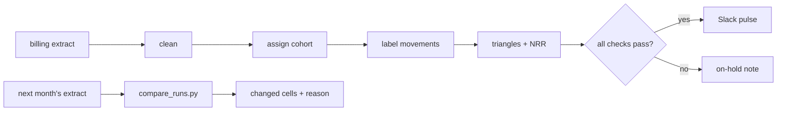
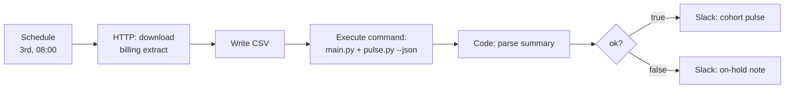

# saas-cohort-retention

[](https://reizaa.github.io/saas-cohort-retention/)
[](https://reizaa.github.io/data-portfolio/)
[](https://reizaa.github.io/saas-cohort-retention/#data-profile)

**Live, interactive walkthrough:** https://reizaa.github.io/saas-cohort-retention/ (segment and metric toggles, refresh before/after, failed-check simulation, data profile)

Monthly cohort reporting for a subscription business: revenue and retention triangles,
churn, upgrade/downgrade value, and net revenue retention (NRR), split into SMB and
Enterprise. Once a month it runs on its own (n8n) and drops a short summary in Slack -
but only if the numbers reconcile.

Everything here runs on synthetic data (`company_001`, `company_002`, ...).
**Live walkthrough:** open `docs/index.html` (or the GitHub Pages link once enabled).

## Why I built this

I used to rebuild the cohort table in a spreadsheet every month. Each refresh brought
late invoices, voided invoices and corrected amounts, so last month's numbers moved and
I'd spend the morning answering "why did the March cohort change?". Two things fixed
that: checking every step against the previous one, and explaining changes at the
account-month level instead of the cell level.

## How it works



1. **Clean** - drop test accounts, zero/negative invoices and duplicates. Every removed
   row has to be accounted for.
2. **Cohort** - an account's cohort is the first month it paid; age is months since then.
3. **Movements** - each account-month vs the month before: new, upgrade, downgrade,
   churn, reactivated. Churned accounts get an explicit zero row in the month after
   their last invoice; without it churn is invisible and the MRR bridge never closes.
4. **Triangles + NRR** - for All, SMB and Enterprise. Unobserved cells stay blank, not
   zero, so per-age averages aren't dragged down by months that haven't happened.

Checks in `validation_report.csv` (all 11 must pass):
revenue conserved through each step, `previous MRR + movements = current MRR` every
month, triangle total = total revenue, retention starts at 100% and never exceeds it.

`compare_runs.py` runs the pipeline on two extracts and lists each changed cell with
the account-month behind it (new invoice / removed invoice / amount changed / cohort
moved). The explained total has to match the triangle difference.

## Automation (n8n) and the Slack pulse

The cohort logic only exists in Python. n8n schedules it, looks at the result and talks
to Slack - so there's one implementation to maintain, not two.



- Runs on the **3rd** rather than the 1st - late invoices for the previous month
  usually arrive in the first couple of days.
- `pulse.py --json` prints the summary plus the ready-made Slack message, so the n8n
  side is just plumbing.
- If a check fails the channel gets "cohort update on hold" with the failed check
  names. No numbers go out that don't reconcile.
- The workflow's error workflow (any unhandled failure) is set to a separate handler
  that DMs the owner - see `revenue-change-tracker` for that one.

Import `automation/n8n/cohort_monthly_pulse.json` (generated by `build_workflow.py`),
then pick your own credentials on the HTTP and Slack nodes and set these env vars on
the n8n host: `BI_BASE_URL`, `BILLING_QUESTION_ID`, `PULSE_CHANNEL_ID`.

Example pulse (dry-run of the dummy data):

```
📊 Cohort update - 2025-12
All NRR 101.9% (+10.8 pt vs prev) | upgrade +2,875, downgrade -618, churn -1,500
SMB NRR 102.7% (+33.9 pt vs prev) | upgrade +125, downgrade -56, churn 0
Enterprise NRR 101.8% (+9.0 pt vs prev) | upgrade +2,750, downgrade -562, churn -1,500
Month-3 retention of the 2025-09 cohort: 66.7% (all cohorts avg 83.8%)
Accounts churned this month: 1
```

## Run it

```bash
pip install -r requirements.txt          # pandas (+ matplotlib for the chart)
python data/generate_dummy_data.py
python src/main.py                       # output/*.csv + output/cohort_chart.png
python src/compare_runs.py               # output/compare/*.csv
python src/pulse.py                      # dry-run -> output/pulse_preview.json
python docs/build_site.py                # rebuilds docs/index.html
```

To actually post: copy `.env.example`, fill in `SLACK_BOT_TOKEN` + `SLACK_CHANNEL`
(or `SLACK_WEBHOOK_URL`) and run `python src/pulse.py --send`.

## Files

```
data/generate_dummy_data.py   synthetic billing data + a "refreshed" copy
src/cohort.py                 cleaning, cohorts, movements, triangles, NRR
src/validate.py               step-by-step checks
src/main.py                   end-to-end run
src/compare_runs.py           explain changes between two extracts
src/pulse.py, slack_client.py monthly Slack summary (dry-run by default)
automation/n8n/               workflow JSON + the script that generates it
docs/                         static walkthrough page (GitHub Pages)
```

## Notes to self

- Check each step against the one before it, not only the final number. Most bugs
  showed up mid-pipeline as "revenue not conserved".
- Argue about account-months, not cells. "2 late invoices and 1 void" ends the
  discussion; "cell C7 changed by 300" starts one.
- Don't post numbers that fail validation, even with a warning. People screenshot them.

Python, pandas, matplotlib, n8n, Slack API, Chart.js (walkthrough page).
